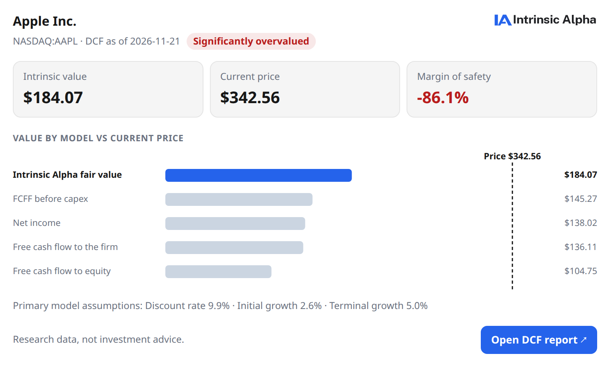
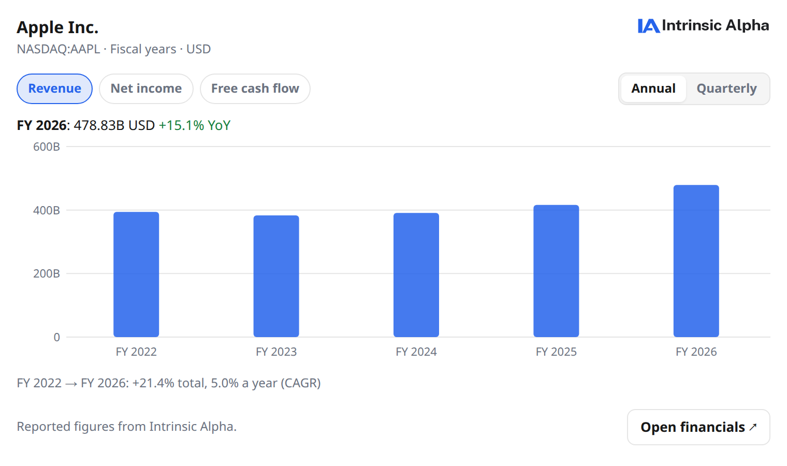

<p align="center">
  <a href="https://intrinsicalpha.com/mcp-server">
    <picture>
      <source media="(prefers-color-scheme: dark)" srcset="assets/logo-white.svg">
      
    </picture>
  </a>
</p>

<h3 align="center">Stock valuation research in your AI assistant</h3>

<p align="center">
  An MCP server and agent skill that give Claude, ChatGPT, Cursor, Codex, and other AI assistants DCF intrinsic values, financial statements, analyst estimates, and interactive charts for U.S.-listed stocks.
</p>

<p align="center">
  <a href="https://intrinsicalpha.com/mcp-server"></a>
  <a href="https://skills.sh"></a>
  <a href="LICENSE"></a>
  
</p>

---

> **You:** Is Apple trading above or below its intrinsic value?
>
> **Claude:** *(calls `get_intrinsic_value`)*

<p align="center">
  
</p>

> **You:** Chart Apple's revenue, net income, and free cash flow for the last five years.
>
> **Claude:** *(calls `get_financial_history`)*

<p align="center">
  
</p>

<sub>Live Intrinsic Alpha data for NASDAQ:AAPL, captured November 21, 2026. Cards and charts render inline in clients that support MCP Apps (Claude, ChatGPT); other clients receive the same data as text. Research data, not investment advice.</sub>

## What's in this repo

| | |
|---|---|
| **[`skills/intrinsic-alpha`](skills/intrinsic-alpha/SKILL.md)** | An [Agent Skill](https://agentskills.io) that teaches your assistant to pick the right tool, use your weekly allowances sparingly, read a DCF correctly, and cite figures with report links. |
| **[`.mcp.json`](.mcp.json)** | The remote MCP server config: `https://intrinsicalpha.com/mcp` |
| **[`.claude-plugin/`](.claude-plugin)** | A Claude Code plugin and marketplace that installs the skill and the server together. |
| **[`plugin.json`](plugin.json) + [`mcp.json`](mcp.json)** | A ChatGPT and Codex plugin ([Agent Plugins](https://agent-plugins.org) format) that bundles the skill and the server, with a Codex marketplace in [`.agents/plugins/`](.agents/plugins/marketplace.json). |

The skill works without the server's internals. It tells the assistant how to use the server well. The server does the work.

## Quick start

### 1. Connect the MCP server

**Server URL:** `https://intrinsicalpha.com/mcp`. Sign-in is OAuth: your browser opens Intrinsic Alpha, you sign in with your account ([free accounts work](https://intrinsicalpha.com/signup)), and you approve the app. There is no API key.

<details>
<summary><b>Claude</b> (claude.ai, desktop, mobile)</summary>

**Settings → Connectors → Add custom connector**, paste `https://intrinsicalpha.com/mcp`, then **Connect** and sign in.
</details>

<details>
<summary><b>Claude Code</b></summary>

```bash
claude mcp add --transport http intrinsic-alpha https://intrinsicalpha.com/mcp
```

Run `/mcp`, select `intrinsic-alpha`, and choose **Authenticate**. Or install the plugin in step 2, which adds the server for you.
</details>

<details>
<summary><b>ChatGPT</b></summary>

Turn on developer mode in **Settings → Apps & Connectors**, create a connector with `https://intrinsicalpha.com/mcp`, and choose OAuth.
</details>

<details>
<summary><b>Cursor</b></summary>

Add this to `.cursor/mcp.json` or `~/.cursor/mcp.json`:

```json
{ "mcpServers": { "intrinsic-alpha": { "url": "https://intrinsicalpha.com/mcp" } } }
```
</details>

<details>
<summary><b>VS Code, Codex, Gemini CLI, and others</b></summary>

See [references/connect.md](skills/intrinsic-alpha/references/connect.md). Any client that supports remote Streamable HTTP servers with OAuth can connect. Stdio-only clients can use `npx -y mcp-remote https://intrinsicalpha.com/mcp`.
</details>

### 2. Add the skill

**Any agent** (Claude Code, Cursor, Codex, Gemini CLI, GitHub Copilot, and [others](https://skills.sh)), using [skills.sh](https://skills.sh):

```bash
npx skills add IntrinsicAlpha/skills
```

**Claude Code plugin** (skill and MCP server in one step):

```text
/plugin marketplace add IntrinsicAlpha/skills
/plugin install intrinsic-alpha@intrinsic-alpha
```

**Codex plugin** (skill and MCP server in one step):

```bash
codex plugin marketplace add IntrinsicAlpha/skills
codex plugin add intrinsic-alpha@intrinsic-alpha
codex mcp login intrinsic-alpha
```

**ChatGPT plugin:** install Intrinsic Alpha from the ChatGPT Plugin Directory once it is listed. Until then, add the server as a connector (step 1).

**Claude.ai:** zip the [`skills/intrinsic-alpha`](skills/intrinsic-alpha) folder and upload it as a custom skill in Claude's settings.

**Manually:** copy `skills/intrinsic-alpha` into your agent's skills folder, such as `~/.claude/skills/`.

### 3. Ask

```text
Is Microsoft trading above or below its intrinsic value?
Chart Apple's revenue and free cash flow over the last five years.
How does Coca-Cola compare with PepsiCo on margins and valuation?
What do analysts expect for Amazon's EPS next year?
How much of Nvidia's revenue comes from data center?
Check Ford's balance sheet. Is there any distress risk?
Ask Intrinsic Alpha what drives NVIDIA's DCF value and where the risks are.
```

## Tools

Twelve tools on one account. Data tools are free; valuations and AI answers use the same weekly allowances as the website.

| Tool | What it returns | Cost |
|---|---|---|
| `search_stocks` | Tickers, exchanges, sectors, and report links by name or ticker | Free |
| `get_stock_snapshot` | Profile, multiples, and the latest annual statements, ratios, and key metrics | Free |
| `get_financial_statements` | Annual or quarterly income statement, balance sheet, cash flow, ratios, and key metrics | Free |
| `get_financial_history` | Up to 6 metrics over 12 periods with YoY change and CAGR, as an **interactive chart** | Free |
| `get_estimates` | Consensus revenue and EPS estimates and price targets | Free |
| `get_analyst_ratings` | Buy, hold, and sell breakdown, rating history, upgrades and downgrades | Free |
| `get_peers` | Competitors with comparison figures | Free |
| `get_revenue_segments` | Revenue by product line or geography | Free |
| `get_financial_scores` | Piotroski F-Score and Altman Z-Score with inputs | Free |
| `get_usage` | Your plan and remaining weekly allowances | Free |
| `get_intrinsic_value` | System DCF: intrinsic value, price, margin of safety, and five models, as an **interactive card** | 1 weekly unlock per new ticker |
| `ask_intrinsic_alpha` | Written analysis from Intrinsic Alpha's research agent, with sources (EN, ES, or DE) | 1 weekly AI prompt |

| Plan | Intrinsic value unlocks / week | AI prompts / week |
|---|---|---|
| Free | 5 | 3 |
| Premium | 15 | 20 |
| Unlimited | Unlimited | Unlimited |

Tickers already unlocked this week are free to re-check, and `AAPL` is always free. See [pricing](https://intrinsicalpha.com/pricing).

## What the skill adds

Without guidance, an assistant tends to call the expensive tool for every ticker it sees, recompute growth rates by hand, and misread margin of safety. The skill fixes that:

- **Budget-aware:** it answers from free tools first, spends a valuation unlock only when you ask for a valuation, and asks before valuing more than two new tickers.
- **Reads DCF correctly:** it explains margin of safety, the verdict bands, the five models (IA fair value, FCFF, FCFF before capex, FCFE, net income), and how much they disagree.
- **Quotes, doesn't recompute:** it uses the server's formatted values, period labels, and currencies.
- **Cites sources:** every answer links the Intrinsic Alpha report so you can check the figures and change the assumptions.
- **Playbooks:** quick valuation, full research brief, peer comparison, trends, estimates, revenue mix, and a financial health screen. See [`references/playbooks.md`](skills/intrinsic-alpha/references/playbooks.md).

## Privacy and security

Read the full [privacy policy](https://intrinsicalpha.com/privacy-policy).

- Every call runs as you, with your plan's limits. Connecting does not add a separate allowance.
- Nothing happens without approval. Each app goes through Intrinsic Alpha's sign-in and consent screen, which shows the app's name and where you return.
- The tools read market data and your plan usage. They never read your watchlists, journal, notes, or saved DCF scenarios. Approved apps can see your name and email.
- Coverage: companies listed on U.S. exchanges, including foreign issuers and ADRs listed there.

## FAQ

**Is this investment advice?** No. Intrinsic Alpha provides research data and educational analysis, not personalized financial advice. AI assistants can make mistakes, so check important figures in the linked report.

**Do I need a paid plan?** No. Free accounts can connect, and all data tools are unmetered.

**Where does the data come from?** From the same database behind Intrinsic Alpha's stock reports. Answers link to those reports.

**Can I self-host the server?** No. The MCP server is a hosted service. This repository contains the open-source skill and the client configuration.

## Contributing

Issues and pull requests are welcome, especially new playbooks, client setup guides, and fixes to the skill's instructions. Keep `SKILL.md` short; detailed material belongs in `references/`.

## License

[MIT](LICENSE). The Intrinsic Alpha name and logo belong to Intrinsic Alpha and are not covered by the license.
